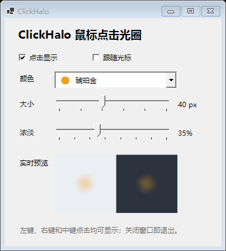
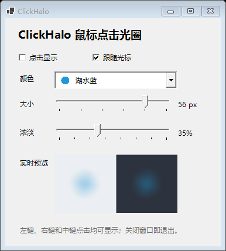

# ClickHalo

Windows 鼠标提示工具：提供点击扩散圆盘和跟随光标两种互斥模式，支持六种配色、24–64 像素大小、10%–80% 光圈浓淡、柔和星云渐变及浅色/深色背景预览。

## 使用

下载 `ClickHalo.exe` 并运行，选择模式、颜色和大小。关闭窗口退出。程序尝试在截图中排除光圈，但不同截图或录屏工具可能不支持这一机制。切换前台窗口时会重新置顶跟随光圈，以减少被其他置顶窗口遮挡的情况。部分全屏应用以及截图工具的表现可能不同；设置当前不会在退出后保存。

## 界面演示

**点击显示**：点击鼠标时出现柔和扩散的星云光晕。可选择颜色、大小和浓淡，预览区展示浅色与深色背景下的效果。



**跟随光标**：选择后圆盘持续跟随鼠标，点击显示与跟随光标不能同时开启。下图展示湖水蓝和较大尺寸的预览。



图片展示程序设置界面的实际预览；由于截图排除功能，屏幕上的独立光圈窗口可能不会出现在截图中。

## 构建

需要 Windows 和 .NET Framework 4.x。使用开发者命令提示符或 PowerShell：

```powershell
& "$env:WINDIR\Microsoft.NET\Framework64\v4.0.30319\csc.exe" /nologo /target:winexe /platform:anycpu /out:ClickHalo.exe /reference:System.Windows.Forms.dll /reference:System.Drawing.dll ClickHalo.cs
```

## 致谢与来源

本项目参考了 [CuiLiang 的 ClickShow](https://github.com/cuiliang/ClickShow) 的功能和架构，感谢原作者。ClickHalo 是根据对 ClickShow 程序结构的分析重新编写的实现，并非原仓库的直接 fork 或源码补丁。原项目采用 MIT 许可证，原许可文本见 `NOTICE-ClickShow.txt`。

